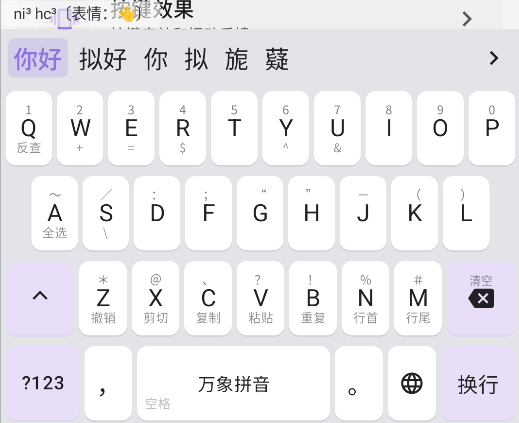
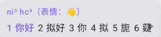
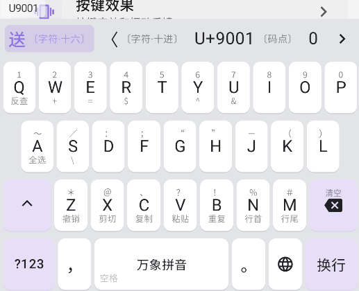
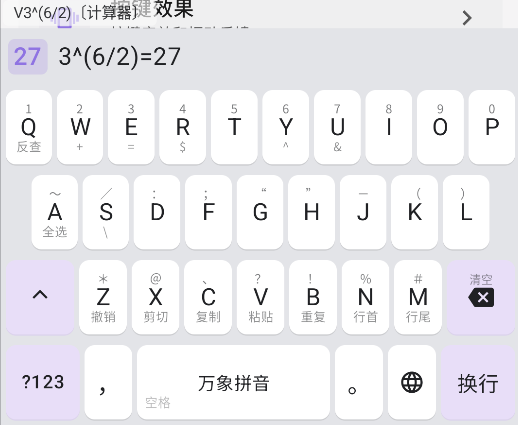

  

<h1 align="center">Xime - Wubi / Pinyin Input Method for Android</h1>

原仓库：https://github.com/ximeiorg/Xime

项目基于 Xime v3.1.0，针对万象拼音输入方案做专项适配。
> 注：本 fork 版不可与原版同时安装。

### 声调标注

当每页候选词数调整至6时，数字键 `7` `8` `9` `0` 可用于标注[声调](https://amzxyz.github.io/rime-wanxiang/doc/aux_code.html?h=%E5%A3%B0%E8%B0%83#1-7890)。 

<table align="center">
  <tr>
    <td> 
声调输入（虚拟键盘）
</td>
    <td> 
声调输入（实体键盘）
</td>
  </tr>
</table>

### 魔法字母
大写字母进入编辑区，可使用[魔法字母](https://amzxyz.github.io/rime-wanxiang/doc/RUNV.html) `R` `U` `N` `V`。

<table align="center">
  <tr>
    <td> 
Unicode模式
</td>
    <td> 
计算器模式
</td>
  </tr>
</table>

### 自定义设备标识和同步目录
在“同步与备份”设置中，可自由修改设备的 `installation_id`，支持将词库快照 `*.userdb.txt` 自动复制到外部目录，以便进行多设备同步。
